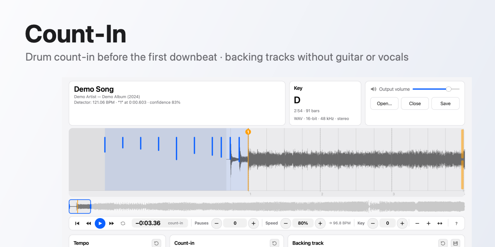
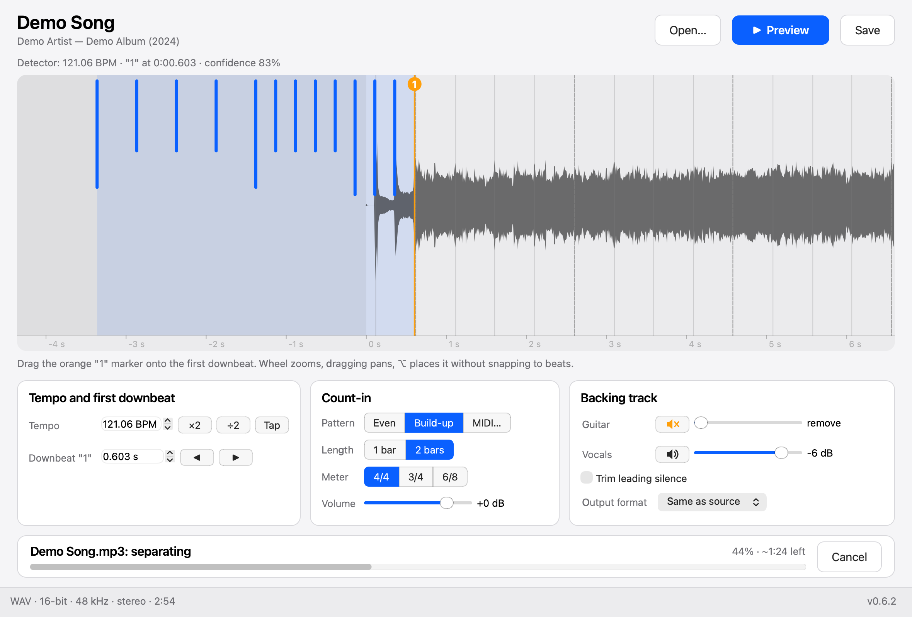
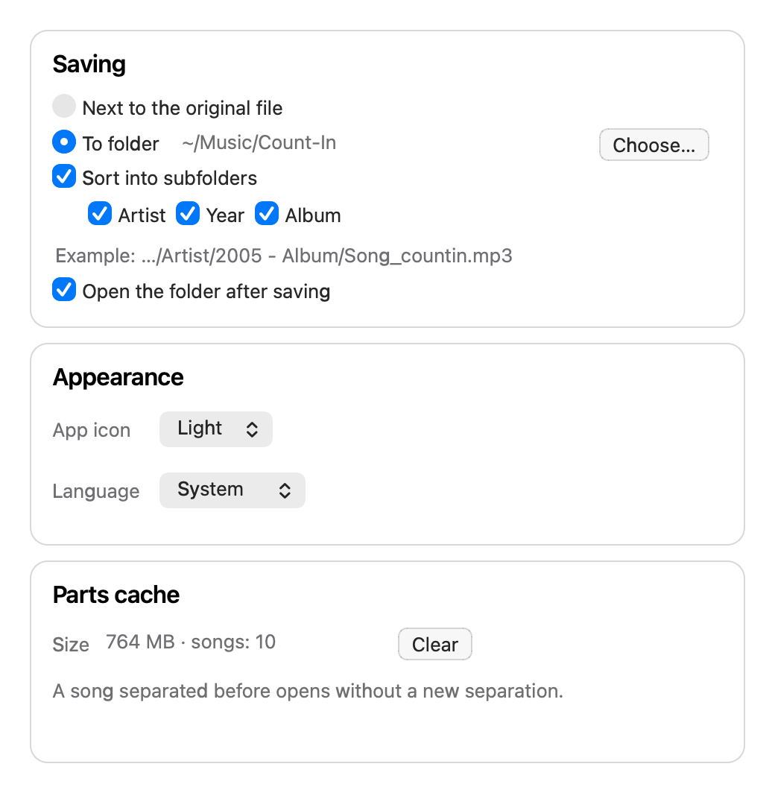
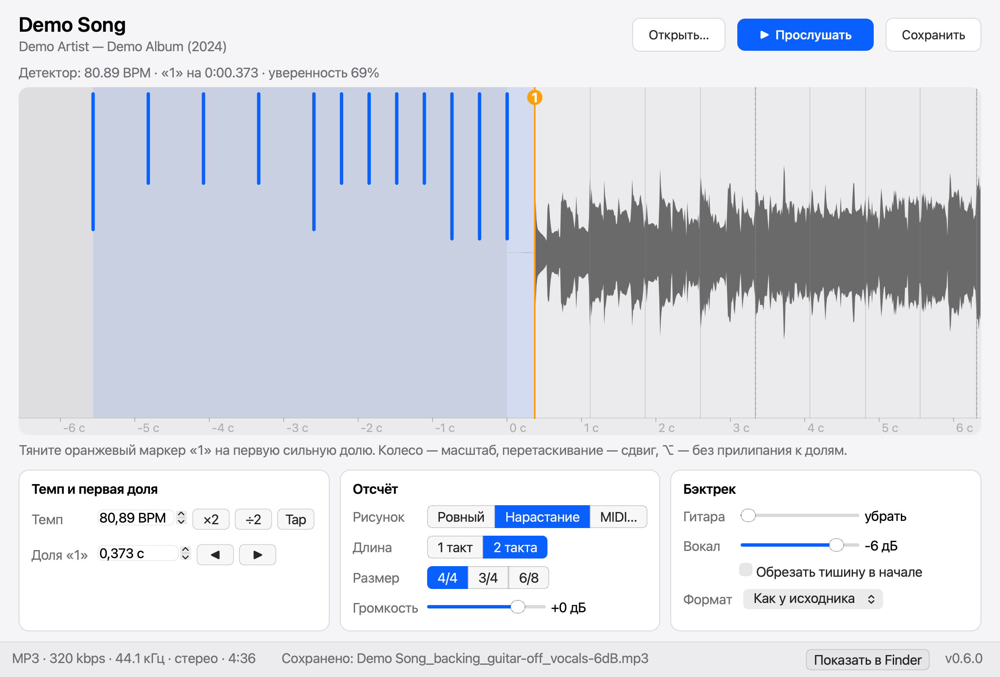
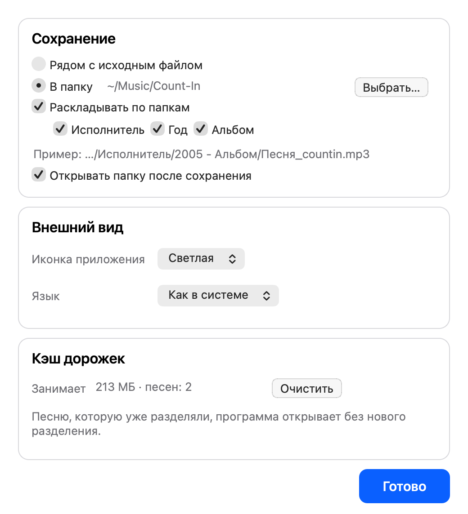
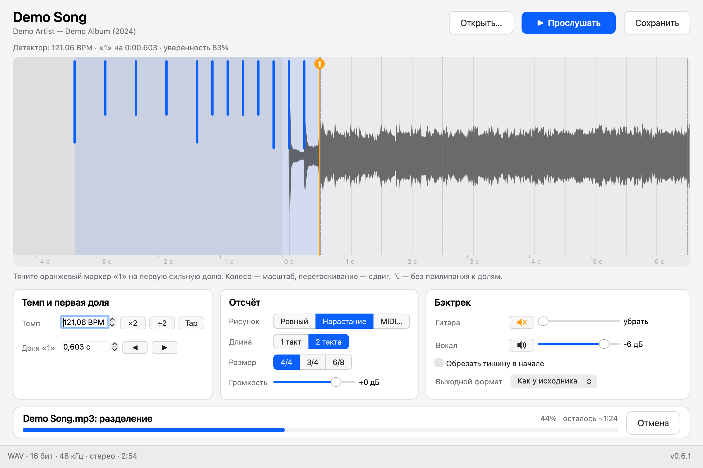

<p align="center"></p>

# Count-In

[count-in.app](https://count-in.app) · [Telegram](https://t.me/count_in_app) · [English](#count-in) · [Русский](#русский)

Count-In finds a song's tempo and first downbeat and puts a drum count-in in front of it. If the song starts with a pickup, the count-in ends before it and the grid starts from the first full bar. The same song can become a backing track with the guitar and vocals removed or turned down.

- Count-in of 1 or 2 bars in 4/4, 3/4 or 6/8.
- Patterns: even, build-up (eighths over the second half of the last bar, louder hit by hit) or your own from a MIDI file.
- Editable tempo track: change BPM, meter and grid alignment by section. Tap Tempo loops the passage and plays a click with each tap.
- Count-in and whole-song metronome have separate sounds and levels. The defaults are sticks and closed hi-hat.
- A neural network separates the song into guitar, vocals, bass, drums and piano in one pass. Each part has a level from removed to +6 dB, a mute button and a solo button.
- Pauses: bars that go quiet once parts are removed get a hi-hat on every beat, as loud as the music around them, with an optional build-up into the band's entry.
- Loop: select bars and play them round. The speed trainer adds 5% every two laps, and a bar of count-in can lead into every start from mid-song.
- Speed and key: slow the song down to 50% with the pitch kept, or shift it by up to 6 semitones with the tempo kept. The app also shows the song's key.
- Navigation: a ruler in bars, Go to Bar, and named section markers on keys 1–9.
- Set list: open several songs at once and step through them with N and P. A page-turner pedal starts and stops playback.
- Saving: one file, a stage mix with the click on the left and the music on the right, even loudness at −14 LUFS, or a multitrack for a DAW with the parts, the click and the tempo map.
- The app remembers the settings of every song. Undo and redo cover the tempo, the "1", pauses and markers.
- Separation runs on the GPU, through Core ML on a Mac and DirectML on Windows. A song separated once opens instantly next time.
- Input: mp3, FLAC, ALAC (M4A), WAV, AIFF, OGG. Output: MP3 320 kbps, FLAC, ALAC or WAV, with tags and cover art kept.
- Works offline. The network is used for the one-time model download and for updates.

News, releases and feedback: the Telegram channel [@count_in_app](https://t.me/count_in_app).

The interface is in English and Russian; it follows the system language, and Settings can switch it. The [user guide](https://count-in.app/guide/) walks through every feature with screenshots; the app opens it from Help (F1).

## Download

Get the latest version from [Releases](https://github.com/shurshun/count-in/releases/latest).

| System | File |
|---|---|
| Windows 10/11, x64 | `Count-In-windows-x64.zip` |
| macOS 14+, Apple Silicon | `Count-In-macos-arm64.zip` |

The macOS build is signed and notarized by Apple. The Windows build is not signed yet, so Windows warns once.

- **Windows.** Unzip and run `Count-In.exe`. If SmartScreen appears, click "More info" → "Run anyway".
- **macOS.** Unzip, drag `Count-In.app` to Applications and open it.

## How to use



The app follows the system appearance and has a dark theme too.

1. Drop a track onto the window, click the drop area or open it with ⌘O. Recent songs are listed there too. The app analyzes it and starts separating the parts in the background right away; a card over the waveform shows the progress and tips.
2. Check the orange "1" marker on the waveform. If the detector got it wrong, drag the marker to the right beat or use the arrows in the Tempo card; the round arrow brings back what the detector found. The wheel zooms, dragging pans, the overview under the waveform shows the whole song.
3. Pick the count-in pattern, length and meter. Blue marks on the waveform show where the clicks will sound. Tempo, the "1", pauses and markers can be undone with ⌘Z.
4. For a backing track, lower the part sliders in the Backing track card. A slider also goes up to +6 dB, and the S button plays a part alone. With "Fill pauses with hi-hat" on, quiet stretches get a hi-hat; the silence threshold fits itself to the song, and the − and + buttons in the bar under the waveform remove or add a pause.
5. Press Play or Space. A click on the waveform or the overview moves the playhead at once, even while the song plays, and ← and → jump between pauses. Levels change while it plays.
6. To practise a passage, drag across its bars with Shift and choose Play in a Loop. Speed slows the song down to 50%, Key shifts it by semitones, and the speed trainer in the Playback menu speeds the loop up step by step.
7. Press M to name a section at the playhead, then jump to it with keys 1–9. The ruler under the waveform counts bars, and ⌘G goes to a bar by its number.
8. Press Save or ⌘S. By default the file goes next to the original, and Finder or Explorer opens with it selected; turn that off in Settings. Save offers a backing track as one file or a multitrack for a DAW. The one file can be in the source format, MP3, FLAC, ALAC or WAV, at an even loudness of −14 LUFS, or a stage mix with the click on the left and the music on the right. The multitrack holds the parts as WAV, the click grid and tempo map as MIDI and, if you like, the click as a WAV, all starting on bar 1. The window shows the file or folder name before it saves.

The app remembers what you set for each song and brings it back when the song opens again. Several songs opened at once make a set list.

### Keys

| Key | What it does |
|---|---|
| Space, PageDown | play or stop |
| Home | back to the count-in |
| PageUp | play again from the loop start, the playhead or the count-in |
| ← → | previous and next pause |
| L | loop on and off |
| M | add a section marker |
| 1–9 | jump to a section marker |
| N, P | next and previous song of the set list |
| ⌘G | go to a bar |
| ⌘[ ⌘] | slower and faster |
| ⌘Z, ⇧⌘Z | undo and redo |
| ⌘+ ⌘− ⌘0 | zoom in, zoom out, whole track |

On Windows, Ctrl works in place of ⌘, and Ctrl+Y redoes a change. PageDown and PageUp are the keys a page-turner pedal sends.

In Settings (⌘,) you can pick one output folder and have files sorted into Artist / Year - Album subfolders from the source tags; each level is a checkbox.



The bottom bar shows the file format, bitrate or bit depth, sample rate and length, plus the app version.

When the detector is unsure, an orange hint appears above the waveform. ×2 and ÷2 fix a doubled or halved tempo; Tap sets the tempo by tapping.

### File names

| What was done | Name |
|---|---|
| Count-in only | `Song_countin.mp3` |
| Backing track | `Song_backing_guitar-off_vocals-6dB.mp3` |
| Slowed to 80% | `Song_backing_guitar-off_80pct.mp3` |
| Two semitones up | `Song_countin_+2st.mp3` |
| Stage mix | `Song_countin_stage.mp3` |

### Processing time

The count-in and analysis take seconds. Separation starts as soon as a track opens and runs on the GPU: about 50 seconds for a 3-minute song on an Apple Silicon Mac (Core ML), on Windows through DirectML on any DirectX 12 graphics card. On a laptop with two graphics cards the app picks the discrete one. You can listen and edit while it runs; the part you are listening to gets separated ahead of the rest. A song separated once comes from the cache next time; Settings show its size and clear it.

On first launch the app downloads its models once: about 780 MB on a Mac, plus a 712 MB GPU model on Windows. An `assets` folder next to the app works too, for a copy on a flash drive.


### Updates

On start, the app checks GitHub for a newer version and downloads it in the background, checking its SHA-256 against the release. When it is ready, a round blue badge appears left of the version in the bottom right corner, and the menu offers "Restart to Update". Without a restart, the update installs when you quit. "Check for Updates…" sits in the app menu on macOS and under Help on Windows.

The app updates itself only from a folder it can write to. Run from Downloads on macOS without moving it, or from a protected folder, the badge opens the download page instead.

### Reporting a problem

Help → Report a Problem… sends your description to the author. You choose whether details about the computer and the app log go with it; no audio is sent, though the log may name the songs you opened.

---

## Development

[AGENTS.md](AGENTS.md) explains how the code works, why these technologies were chosen and where to change things.

### Environment

```bash
brew install ffmpeg            # or packaging/build_ffmpeg.sh, the LGPL build that goes into bin/
uv sync
packaging/fetch_models.sh      # beat_this final0 (81 MB), BS-RoFormer SW (700 MB)
```

### Run

```bash
uv run countin-gui [files...]                        # the app
uv run countin song.mp3 --style buildup --bars 2     # command line
uv run countin *.mp3 --dry-run                       # table: BPM, first downbeat, confidence
uv run countin-verify out.mp3 --last-click 2.22526   # where the last click actually landed
```

| Flag | What it does |
|---|---|
| `--bars 1\|2` | count-in length |
| `--meter 4/4\|3/4\|6/8` | meter; 6/8 clicks six eighths over two beats |
| `--style even\|buildup` | even count-in or build-up |
| `--pattern file.mid` | pattern from MIDI, length rounded up to whole bars |
| `--bpm`, `--first-beat SEC` | set tempo and first downbeat by hand |
| `--tempo-x2`, `--tempo-half` | fix a doubled or halved tempo |
| `--pre-roll keep\|trim` | `keep` puts clicks over the intro, `trim` first cuts leading silence |
| `--volume DB` | count-in volume |
| `--guitar-db DB`, `--vocals-db DB` | backing track levels, `--guitar-db=-inf` removes the guitar |
| `--out`, `--format mp3\|flac\|alac\|wav` | output format, defaults to the source format |

### Tests

```bash
uv run pytest -m 'not slow'    # fast
uv run pytest                  # including a neural network run
```

### Build and release

```bash
uv run pyinstaller packaging/countin.spec --noconfirm --distpath build/dist --workpath build/work  # app and CLI in one bundle
```

CI (`.github/workflows/build.yml`) builds Windows x64 and macOS arm64 for every pull request that touches code and runs the bundled CLI end to end; docs-only changes skip it. To release, bump `version` in `pyproject.toml` and tag `v<version>`. CI publishes both archives to Releases, and the in-app update check compares against that version.

## License

Count-In is released under the [MIT License](LICENSE). The bundled third-party components below keep their own licenses.

## Third-party components

| Component | License |
|---|---|
| [beat_this](https://github.com/CPJKU/beat_this) (beat detector, code and weights) | MIT |
| BS-RoFormer code from [python-audio-separator](https://github.com/nomadkaraoke/python-audio-separator), based on [lucidrains/BS-RoFormer](https://github.com/lucidrains/BS-RoFormer) | MIT |
| BS-RoFormer SW weights (jarredou) | author's terms, no explicit license |
| [FFmpeg](https://ffmpeg.org), built without GPL parts, with LAME | LGPL |
| [Qt for Python](https://doc.qt.io/qtforpython-6/) | LGPL |
| [PyTorch](https://pytorch.org) | BSD |
| [Signalsmith Stretch](https://github.com/Signalsmith-Audio/signalsmith-stretch) via [python-stretch](https://github.com/gregogiudici/python-stretch) (slowing down) | MIT |
| [coremltools](https://github.com/apple/coremltools) (macOS) | BSD |
| [ONNX Runtime DirectML](https://onnxruntime.ai) (Windows) | MIT |

---

## Русский

Новости, релизы и обратная связь — в Telegram-канале [@count_in_app](https://t.me/count_in_app).

Count-In находит темп и первую сильную долю песни и вставляет перед ней барабанный отсчёт. При затакте отсчёт заканчивается перед вступлением, а сетка строится от первого полного такта. Из той же песни можно сделать бэктрек: убрать или приглушить гитару и вокал.

- Отсчёт на 1 или 2 такта, размер 4/4, 3/4 или 6/8.
- Рисунок: ровный, «нарастание» (восьмые во второй половине последнего такта, каждый удар громче предыдущего) или свой из MIDI-файла.
- Темпотрек: меняйте BPM, размер и положение сетки по участкам. Tap Tempo зацикливает фрагмент и озвучивает каждое нажатие.
- У отсчёта и метронома на всю песню отдельные звуки и громкость. По умолчанию палочки и закрытый хай-хэт.
- Нейросеть за один проход разделяет песню на гитару, вокал, бас, барабаны и пианино. У каждой дорожки есть уровень от «убрать» до +6 дБ, кнопка отключения и кнопка соло.
- Паузы: такты, где без убранных инструментов тихо, получают хай-хэт на каждую долю, громкостью как музыка вокруг, и по желанию нарастание к вступлению группы.
- Петля: выделите такты и играйте их по кругу. Тренажёр скорости прибавляет 5% каждые два круга, а перед стартом с середины песни может звучать такт отсчёта.
- Скорость и тон: песню можно замедлить до 50% без смены тона или сдвинуть на полутона, до шести вверх или вниз, без смены темпа. Программа показывает и тональность песни.
- Навигация: линейка в тактах, переход к такту по номеру и именованные метки частей на клавишах 1–9.
- Сет-лист: откройте несколько песен сразу и листайте их клавишами N и P. Педаль для перелистывания нот запускает и останавливает прослушивание.
- Сохранение: один файл, микс для сцены с кликом слева и музыкой справа, ровная громкость −14 LUFS или мультитрек для DAW с дорожками, кликом и темповой картой.
- Программа помнит настройки каждой песни. Отмена и повтор действуют на темп, «1», паузы и метки.
- Разделение идёт на видеокарте, через Core ML на Mac и DirectML на Windows. Песню, которую уже разделяли, программа открывает сразу.
- Вход: mp3, FLAC, ALAC (M4A), WAV, AIFF, OGG. Выход: MP3 320 kbps, FLAC, ALAC или WAV, теги и обложка сохраняются.
- Работает без интернета. Сеть нужна для одной загрузки моделей и для обновлений.
- Интерфейс на русском и английском. Язык берётся из системы, его можно сменить в настройках. [Справка](https://count-in.app/ru/guide/) со скриншотами описывает все возможности, программа открывает её из меню «Справка» (F1).

### Скачать

Последняя версия лежит на странице [Releases](https://github.com/shurshun/count-in/releases/latest).

| Система | Файл |
|---|---|
| Windows 10/11, x64 | `Count-In-windows-x64.zip` |
| macOS 14+, Apple Silicon | `Count-In-macos-arm64.zip` |

Сборка для macOS подписана и заверена Apple. Сборка для Windows пока не подписана, поэтому Windows один раз предупредит.

- **Windows.** Распакуйте архив и запустите `Count-In.exe`. Если появится SmartScreen, нажмите «Подробнее» → «Выполнить в любом случае».
- **macOS.** Распакуйте архив, перетащите `Count-In.app` в «Программы» и откройте.

### Как пользоваться



Программа следует оформлению системы, есть и тёмная тема.

1. Перетащите трек в окно, щёлкните по области для перетаскивания или откройте его через ⌘O. Там же есть список недавних песен. Программа анализирует трек и сразу начинает в фоне разделять на дорожки; карточка поверх волны показывает прогресс и советы.
2. Проверьте оранжевый маркер «1» на волне. Если детектор ошибся, перетащите маркер на нужную долю или сдвиньте стрелками в карточке «Темп»; круглая стрелка возвращает найденное детектором. Колесо меняет масштаб, перетаскивание сдвигает волну, обзор трека под волной показывает всю песню.
3. Выберите рисунок, длину и размер отсчёта. Синие отметки на волне показывают, где прозвучат клики. Правку темпа, «1», пауз и меток отменяет ⌘Z.
4. Для бэктрека опустите ползунки в карточке «Бэктрек». Ползунок поднимается и до +6 дБ, а кнопка S оставляет дорожку одну. С галочкой «Заполнять паузы хай-хэтом» тихие места получают хай-хэт; порог тишины подбирается сам, кнопки − и + под волной убирают и добавляют паузы.
5. Нажмите Play или пробел. Щелчок по волне или обзору трека сразу переносит плейхед, даже во время прослушивания, ← и → переходят по паузам. Уровни меняются на ходу.
6. Чтобы разучить фрагмент, протяните по его тактам с Shift и выберите «Играть по кругу». Блок «Скорость» замедляет песню до 50%, блок «Тон» сдвигает её на полутона, а тренажёр скорости в меню «Воспроизведение» шаг за шагом ускоряет петлю.
7. Клавиша M ставит под плейхедом метку части с названием, клавиши 1–9 переходят к меткам. Линейка под волной считает такты, ⌘G переходит к такту по номеру.
8. Нажмите «Сохранить» или ⌘S. По умолчанию файл ложится рядом с исходником, а Finder или Проводник открывается с ним; это отключается в настройках. Окно сохранения предлагает бэктрек одним файлом или мультитрек для DAW. Один файл пишется в формате исходника, MP3, FLAC, ALAC или WAV, по желанию с ровной громкостью −14 LUFS или как микс для сцены с кликом слева и музыкой справа. В мультитреке лежат дорожки в WAV, сетка кликов и темповая карта в MIDI и по желанию клик отдельным WAV, все с первого такта. Имя файла или папки видно до сохранения.

Программа помнит, что вы настроили в каждой песне, и возвращает это при следующем открытии. Несколько песен, открытых сразу, становятся сет-листом.

#### Клавиши

| Клавиша | Что делает |
|---|---|
| Пробел, PageDown | прослушать или остановить |
| Home | к отсчёту |
| PageUp | играть сначала: с начала петли, с плейхеда или с отсчёта |
| ← → | предыдущая и следующая пауза |
| L | включить или выключить петлю |
| M | поставить метку части |
| 1–9 | перейти к метке части |
| N, P | следующая и предыдущая песня сет-листа |
| ⌘G | перейти к такту |
| ⌘[ ⌘] | медленнее и быстрее |
| ⌘Z, ⇧⌘Z | отменить и повторить |
| ⌘+ ⌘− ⌘0 | приблизить, отдалить, весь трек |

На Windows вместо ⌘ работает Ctrl, а правку повторяет Ctrl+Y. PageDown и PageUp посылает педаль для перелистывания нот.

В настройках (⌘,) можно один раз выбрать папку для всех файлов и раскладывать их по подпапкам «Исполнитель / Год - Альбом» по тегам исходника, каждый уровень включается галочкой.



В нижней панели видны формат файла, битрейт или разрядность, частота дискретизации, длительность и версия программы.

Если детектор не уверен в результате, над волной появляется оранжевая подсказка. Кнопки ×2 и ÷2 исправляют удвоенный или половинный темп, Tap задаёт темп постукиванием.

#### Имена файлов

| Что сделано | Имя |
|---|---|
| Только отсчёт | `Песня_countin.mp3` |
| Бэктрек | `Песня_backing_guitar-off_vocals-6dB.mp3` |
| Замедлено до 80% | `Песня_backing_guitar-off_80pct.mp3` |
| На два полутона выше | `Песня_countin_+2st.mp3` |
| Микс для сцены | `Песня_countin_stage.mp3` |

#### Время обработки

Отсчёт и анализ занимают секунды. Разделение начинается сразу после открытия трека и идёт на видеокарте: около 50 секунд на 3-минутную песню на Mac с Apple Silicon (Core ML), на Windows через DirectML на любой видеокарте с DirectX 12. На ноутбуке с двумя видеокартами программа выбирает дискретную. Пока оно идёт, можно слушать и править; отрывок для прослушивания разделяется вне очереди. Песня, которую уже разделяли, берётся из кэша; его размер и очистка есть в настройках.

При первом запуске программа один раз скачивает модели: около 780 МБ на Mac и ещё 712 МБ модели для видеокарты на Windows. Подходит и папка `assets` рядом с программой, например на флешке.



#### Обновления

При запуске программа проверяет, нет ли новой версии на GitHub, и в фоне скачивает её, сверяя SHA-256 с релизом. Когда загрузка готова, справа внизу слева от версии появляется круглый голубой значок, а в меню — пункт «Перезапустить и обновить». Если не перезапускать, обновление установится при выходе. «Проверить обновления…» находится в меню программы на macOS и в меню «Справка» на Windows.

Сама обновляется только программа из папки, куда можно писать. Если на macOS запускать её прямо из «Загрузок», не перенося, или из защищённой папки, значок открывает страницу загрузки.

#### Сообщить о проблеме

«Справка → Сообщить о проблеме…» отправляет автору ваше описание. Вы сами решаете, приложить ли сведения о компьютере и журнал программы; звук не уходит, а в журнале могут быть названия открытых песен.

---

### Разработка

Как устроен код, почему выбраны эти технологии и где что менять, описано в [AGENTS.md](AGENTS.md) (на английском).

#### Окружение

```bash
brew install ffmpeg            # или packaging/build_ffmpeg.sh, LGPL-сборка для бандла в bin/
uv sync
packaging/fetch_models.sh      # beat_this final0 (81 МБ), BS-RoFormer SW (700 МБ)
```

#### Запуск

```bash
uv run countin-gui [файлы...]                       # приложение
uv run countin song.mp3 --style buildup --bars 2     # командная строка
uv run countin *.mp3 --dry-run                       # таблица: BPM, первая доля, уверенность
uv run countin-verify out.mp3 --last-click 2.22526   # проверка, где оказался последний клик
```

| Флаг | Что делает |
|---|---|
| `--bars 1\|2` | длина отсчёта |
| `--meter 4/4\|3/4\|6/8` | размер; в 6/8 звучит шесть восьмых на две доли |
| `--style even\|buildup` | ровный отсчёт или нарастание |
| `--pattern file.mid` | рисунок из MIDI, длина округляется до целых тактов |
| `--bpm`, `--first-beat SEC` | ручная правка темпа и первой доли |
| `--tempo-x2`, `--tempo-half` | исправить удвоенный или половинный темп |
| `--pre-roll keep\|trim` | `keep` кладёт клики поверх вступления, `trim` сначала срезает тишину в начале |
| `--volume DB` | громкость отсчёта |
| `--guitar-db DB`, `--vocals-db DB` | уровни для бэктрека, `--guitar-db=-inf` убирает гитару |
| `--out`, `--format mp3\|flac\|alac\|wav` | формат вывода, по умолчанию как у исходника |

#### Тесты

```bash
uv run pytest -m 'not slow'    # быстрые
uv run pytest                  # вместе с прогоном нейросети
```

#### Сборка и релиз

```bash
uv run pyinstaller packaging/countin.spec --noconfirm --distpath build/dist --workpath build/work  # приложение и CLI в одном бандле
```

CI (`.github/workflows/build.yml`) собирает Windows x64 и macOS arm64 для каждого PR с изменениями кода и прогоняет CLI из бандла от начала до конца; PR только с документацией сборку не запускают. Чтобы выпустить релиз, поднимите `version` в `pyproject.toml` и поставьте тег `v<версия>`. CI опубликует оба архива в Releases, а проверка обновлений в программе сравнивает именно эту версию.

### Лицензия

Count-In распространяется по [лицензии MIT](LICENSE). Сторонние компоненты из таблицы ниже сохраняют свои лицензии.

### Сторонние компоненты

| Компонент | Лицензия |
|---|---|
| [beat_this](https://github.com/CPJKU/beat_this) (детектор долей, код и веса) | MIT |
| Код BS-RoFormer из [python-audio-separator](https://github.com/nomadkaraoke/python-audio-separator), на основе [lucidrains/BS-RoFormer](https://github.com/lucidrains/BS-RoFormer) | MIT |
| Веса BS-RoFormer SW (jarredou) | условия автора, явной лицензии нет |
| [FFmpeg](https://ffmpeg.org), сборка без GPL-частей, с LAME | LGPL |
| [Qt for Python](https://doc.qt.io/qtforpython-6/) | LGPL |
| [PyTorch](https://pytorch.org) | BSD |
| [Signalsmith Stretch](https://github.com/Signalsmith-Audio/signalsmith-stretch) через [python-stretch](https://github.com/gregogiudici/python-stretch) (замедление) | MIT |
| [coremltools](https://github.com/apple/coremltools) (macOS) | BSD |
| [ONNX Runtime DirectML](https://onnxruntime.ai) (Windows) | MIT |
