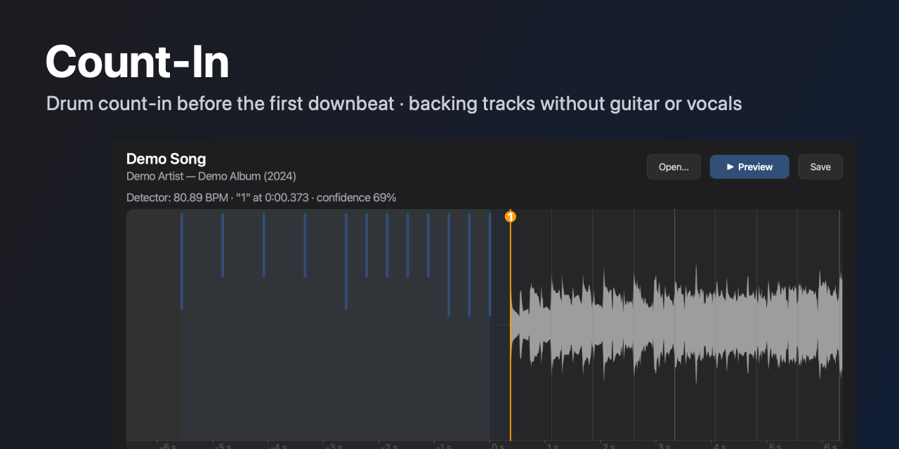
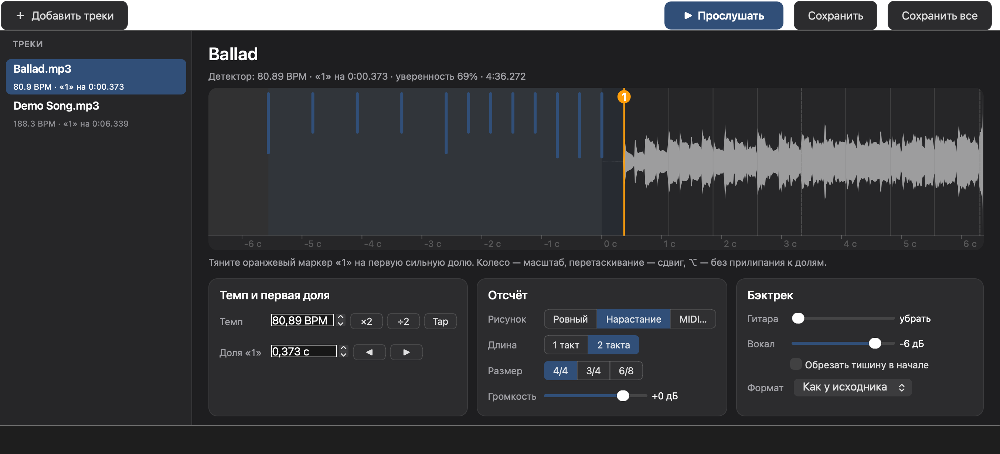
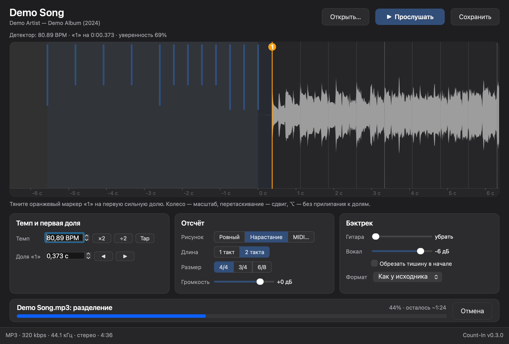

<p align="center"></p>

# Count-In

[English](#count-in) · [Русский](#русский)

Count-In finds a song's tempo and first downbeat and puts a drum count-in in front of it. The last click lands exactly one beat before the "one". The same song can become a backing track with the guitar and vocals removed or turned down.

- Count-in of 1 or 2 bars in 4/4, 3/4 or 6/8.
- Patterns: even, build-up (twice as dense in the second half, the last hits louder) or your own from a MIDI file.
- A neural network separates guitar and vocals in one pass; each has its own level.
- Input: mp3, FLAC, ALAC, WAV. Output: MP3 320 kbps, FLAC, ALAC or WAV, with tags and cover art kept.
- Works offline. The network is used only for the update check.

The app interface is in Russian.

## Download

Get the latest version from [Releases](https://github.com/shurshun/count-in/releases/latest).

| System | File |
|---|---|
| Windows 10/11, x64 | `Count-In-windows-x64.zip` |
| macOS 12+, Apple Silicon | `Count-In-macos-arm64.zip` |

The builds are unsigned, so the system warns on first launch.

- **Windows.** Unzip and run `Count-In.exe`. If SmartScreen appears, click "More info" → "Run anyway".
- **macOS.** Unzip and drag `Count-In.app` to Applications. On first launch, right-click it → "Open".

## How to use



1. Drop a track onto the window or open it with ⌘O. The app works on one track at a time and analyzes it in the background.
2. Check the orange "1" marker on the waveform. If the detector got it wrong, drag the marker to the right beat. It snaps to detected beats; hold ⌥/Alt to place it freely. The mouse wheel zooms, dragging the waveform pans.
3. Pick the pattern, length and meter. Blue marks on the waveform show where the clicks will sound.
4. For a backing track, lower the "Гитара" (guitar) and "Вокал" (vocals) sliders.
5. Press "Прослушать" (preview) or Space to hear the count-in and 10 seconds of the song. The guitar and vocal sliders change the sound while it plays.
6. Press "Сохранить" (save) or ⌘S. By default the file goes next to the original.

In Settings (⌘,) you can pick one output folder and have files sorted into Artist / Year - Album subfolders from the source tags; each level is a checkbox. The bottom bar shows the file format, bitrate or bit depth, sample rate and length, plus the app version.

When the detector is unsure, an orange hint appears above the waveform. ×2 and ÷2 fix a doubled or halved tempo; Tap sets the tempo by tapping.

### File names

| What was done | Name |
|---|---|
| Count-in only | `Song_countin.mp3` |
| Backing track | `Song_backing_guitar-off_vocals-6dB.mp3` |

### Processing time

The count-in and analysis take seconds. Separating guitar and vocals takes longer: about 2.5 minutes for a 4-minute song on an Apple Silicon Mac, and noticeably longer on Windows, where only the CPU does the work. The bottom of the window shows the stage, percent and time left, and the job can be cancelled.



### Updates

On start, the app checks GitHub for a newer version in the background. If there is one, an "Обновить до …" button appears in the bottom bar. Справка → Проверить обновления checks again.

---

## Development

[AGENTS.md](AGENTS.md) explains how the code works, why these technologies were chosen and where to change things.

### Environment

```bash
brew install ffmpeg            # or packaging/build_ffmpeg.sh, the LGPL build that goes into bin/
uv sync
packaging/fetch_models.sh      # beat_this final0 (81 MB), BS-RoFormer SW (700 MB)
```

### Run

```bash
uv run countin-gui [files...]                        # the app
uv run countin song.mp3 --style buildup --bars 2     # command line
uv run countin *.mp3 --dry-run                       # table: BPM, first downbeat, confidence
uv run countin-verify out.mp3 --last-click 2.22526   # where the last click actually landed
```

| Flag | What it does |
|---|---|
| `--bars 1\|2` | count-in length |
| `--meter 4/4\|3/4\|6/8` | meter; 6/8 clicks six eighths over two beats |
| `--style even\|buildup` | even count-in or build-up |
| `--pattern file.mid` | pattern from MIDI, length rounded up to whole bars |
| `--bpm`, `--first-beat SEC` | set tempo and first downbeat by hand |
| `--tempo-x2`, `--tempo-half` | fix a doubled or halved tempo |
| `--pre-roll keep\|trim` | `keep` puts clicks over the intro, `trim` first cuts leading silence |
| `--volume DB` | count-in volume |
| `--guitar-db DB`, `--vocals-db DB` | backing track levels, `--guitar-db=-inf` removes the guitar |
| `--out`, `--format mp3\|flac\|alac\|wav` | output format, defaults to the source format |

### Tests

```bash
uv run pytest -m 'not slow'    # fast
uv run pytest                  # including a neural network run
```

### Build and release

```bash
uv run pyinstaller packaging/countin.spec --noconfirm --distpath build/dist --workpath build/work  # app and CLI in one bundle
```

CI (`.github/workflows/build.yml`) builds Windows x64 and macOS arm64 for every pull request that touches code and runs the bundled CLI end to end; docs-only changes skip it. To release, bump `version` in `pyproject.toml` and tag `v<version>`. CI publishes both archives to Releases, and the in-app update check compares against that version.

## Third-party components

| Component | License |
|---|---|
| [beat_this](https://github.com/CPJKU/beat_this) (beat detector, code and weights) | MIT |
| BS-RoFormer code from [python-audio-separator](https://github.com/nomadkaraoke/python-audio-separator), based on [lucidrains/BS-RoFormer](https://github.com/lucidrains/BS-RoFormer) | MIT |
| BS-RoFormer SW weights (jarredou) | author's terms, no explicit license |
| [FFmpeg](https://ffmpeg.org), built without GPL parts, with LAME | LGPL |
| [Qt for Python](https://doc.qt.io/qtforpython-6/) | LGPL |
| [PyTorch](https://pytorch.org) | BSD |

---

## Русский

Count-In находит темп и первую сильную долю песни и вставляет перед ней барабанный отсчёт. Последний клик звучит ровно за долю до «раз». Из той же песни можно сделать бэктрек: убрать или приглушить гитару и вокал.

- Отсчёт на 1 или 2 такта, размер 4/4, 3/4 или 6/8.
- Рисунок: ровный, «нарастание» (во второй половине вдвое чаще, последние удары громче) или свой из MIDI-файла.
- Гитара и вокал отделяются нейросетью за один проход, уровень каждого настраивается отдельно.
- Вход: mp3, FLAC, ALAC, WAV. Выход: MP3 320 kbps, FLAC, ALAC или WAV, теги и обложка сохраняются.
- Работает без интернета. Сеть нужна только для проверки обновлений.

### Скачать

Последняя версия лежит на странице [Releases](https://github.com/shurshun/count-in/releases/latest).

| Система | Файл |
|---|---|
| Windows 10/11, x64 | `Count-In-windows-x64.zip` |
| macOS 12+, Apple Silicon | `Count-In-macos-arm64.zip` |

Сборки не подписаны, поэтому система при первом запуске предупредит.

- **Windows.** Распакуйте архив и запустите `Count-In.exe`. Если появится SmartScreen, нажмите «Подробнее» → «Выполнить в любом случае».
- **macOS.** Распакуйте архив и перетащите `Count-In.app` в «Программы». При первом запуске откройте его через правый клик → «Открыть».

### Как пользоваться


1. Перетащите трек в окно или откройте его через ⌘O. Приложение работает с одним треком и анализирует его в фоне.
2. Проверьте оранжевый маркер «1» на волне. Если детектор ошибся, перетащите маркер на нужную долю: он прилипает к найденным долям, с ⌥/Alt ставится свободно. Колесо мыши меняет масштаб, перетаскивание волны сдвигает её.
3. Выберите рисунок, длину и размер отсчёта. Синие отметки на волне показывают, где прозвучат клики.
4. Для бэктрека опустите ползунки «Гитара» и «Вокал».
5. Нажмите «Прослушать» или пробел: прозвучит отсчёт и 10 секунд песни. Во время прослушивания ползунки гитары и вокала меняют звук сразу.
6. Нажмите «Сохранить» или ⌘S. По умолчанию файл ложится рядом с исходником.

В настройках (⌘,) можно один раз выбрать папку для всех файлов и раскладывать их по подпапкам «Исполнитель / Год - Альбом» по тегам исходника, каждый уровень включается галочкой. В нижней панели видны формат файла, битрейт или разрядность, частота дискретизации, длительность и версия приложения.

Если детектор не уверен в результате, над волной появляется оранжевая подсказка. Кнопки ×2 и ÷2 исправляют удвоенный или половинный темп, Tap задаёт темп постукиванием.

#### Имена файлов

| Что сделано | Имя |
|---|---|
| Только отсчёт | `Песня_countin.mp3` |
| Бэктрек | `Песня_backing_guitar-off_vocals-6dB.mp3` |

#### Время обработки

Отсчёт и анализ занимают секунды. Разделение на гитару и вокал работает дольше: около 2.5 минут на 4-минутную песню на Mac с Apple Silicon и заметно дольше на Windows, где считает только процессор. Внизу окна видны этап, проценты и оставшееся время, работу можно отменить.


#### Обновления

При запуске приложение в фоне проверяет, нет ли новой версии на GitHub. Если есть, в нижней панели появляется кнопка «Обновить до …». Справка → Проверить обновления проверяет ещё раз.

---

### Разработка

Как устроен код, почему выбраны эти технологии и где что менять, описано в [AGENTS.md](AGENTS.md) (на английском).

#### Окружение

```bash
brew install ffmpeg            # или packaging/build_ffmpeg.sh, LGPL-сборка для бандла в bin/
uv sync
packaging/fetch_models.sh      # beat_this final0 (81 МБ), BS-RoFormer SW (700 МБ)
```

#### Запуск

```bash
uv run countin-gui [файлы...]                       # приложение
uv run countin song.mp3 --style buildup --bars 2     # командная строка
uv run countin *.mp3 --dry-run                       # таблица: BPM, первая доля, уверенность
uv run countin-verify out.mp3 --last-click 2.22526   # проверка, где оказался последний клик
```

| Флаг | Что делает |
|---|---|
| `--bars 1\|2` | длина отсчёта |
| `--meter 4/4\|3/4\|6/8` | размер; 6/8 щёлкает шесть восьмых на две доли |
| `--style even\|buildup` | ровный отсчёт или нарастание |
| `--pattern file.mid` | рисунок из MIDI, длина округляется до целых тактов |
| `--bpm`, `--first-beat SEC` | ручная правка темпа и первой доли |
| `--tempo-x2`, `--tempo-half` | исправить удвоенный или половинный темп |
| `--pre-roll keep\|trim` | `keep` кладёт клики поверх вступления, `trim` сначала срезает тишину в начале |
| `--volume DB` | громкость отсчёта |
| `--guitar-db DB`, `--vocals-db DB` | уровни для бэктрека, `--guitar-db=-inf` убирает гитару |
| `--out`, `--format mp3\|flac\|alac\|wav` | формат вывода, по умолчанию как у исходника |

#### Тесты

```bash
uv run pytest -m 'not slow'    # быстрые
uv run pytest                  # вместе с прогоном нейросети
```

#### Сборка и релиз

```bash
uv run pyinstaller packaging/countin.spec --noconfirm --distpath build/dist --workpath build/work  # приложение и CLI в одном бандле
```

CI (`.github/workflows/build.yml`) собирает Windows x64 и macOS arm64 для каждого PR с изменениями кода и прогоняет CLI из бандла от начала до конца; PR только с документацией сборку не запускают. Чтобы выпустить релиз, поднимите `version` в `pyproject.toml` и поставьте тег `v<версия>`. CI опубликует оба архива в Releases, а проверка обновлений в приложении сравнивает именно эту версию.

### Сторонние компоненты

| Компонент | Лицензия |
|---|---|
| [beat_this](https://github.com/CPJKU/beat_this) (детектор долей, код и веса) | MIT |
| Код BS-RoFormer из [python-audio-separator](https://github.com/nomadkaraoke/python-audio-separator), на основе [lucidrains/BS-RoFormer](https://github.com/lucidrains/BS-RoFormer) | MIT |
| Веса BS-RoFormer SW (jarredou) | условия автора, явной лицензии нет |
| [FFmpeg](https://ffmpeg.org), сборка без GPL-частей, с LAME | LGPL |
| [Qt for Python](https://doc.qt.io/qtforpython-6/) | LGPL |
| [PyTorch](https://pytorch.org) | BSD |
